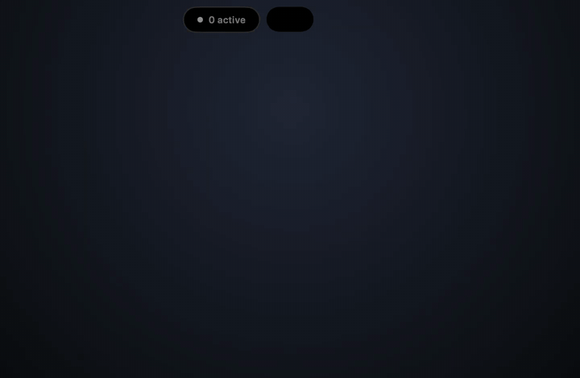

# triage

<p align="center">
  
</p>
<p align="center"><sub>A permission request opens next to the island, one click approves it, and the card lists your agent sessions and running terminals. <a href="docs/media/triage-demo.mp4">Sharper MP4</a>. The sessions shown are made up.</sub></p>

A menu-bar app that shows your **AI coding agent** sessions around the MacBook Pro's Dynamic Island,
and lets you approve or deny permission requests from there. Claude Code is supported out of the
box; any other agent can use it by sending a small hook event ([see below](#using-triage-with-other-agents)).

- **A small status pill** next to the island: "All clear", "N working", and a red flashing
  "N pending" when something is waiting on you.
- **Approve or deny** from an expanded card that shows the full command, the tool's
  description, a before/after preview for edits, and the project and branch.
- **See what each session is doing** ("Editing X.swift", "Running: swift build") with a timer.
- **See running terminals too**: tabs with something in the foreground (a build, a dev server, `ssh`)
  are listed next to your agent sessions, with the command and how long it's been running. The open
  card shows agents and terminals side by side, a few rows each.
- **Jump to a session** in the app that hosts it: Subspace, Ghostty, Kaku, iTerm2, Terminal.app
  and others.
- Works with agents running in terminals, in Subspace, in Cursor, and in the Claude Code desktop app.

> **Status: early (0.1).** Built and tested on a 16" MacBook Pro with a Dynamic Island on macOS 27.
> It needs macOS 14 or later. On a Mac with a notch, or without one, it falls back to a floating
> pill, but that hasn't been tried.

## Install

```
brew install --cask dkeg/triage/triage
```

Or download `Triage-<version>.zip` from the [releases](https://github.com/dkeg/triage/releases),
unzip it and drag `Triage.app` to Applications.

On first launch triage offers to **connect to Claude Code** (adds hook entries to
`~/.claude/settings.json`) and to **start at login**. You can do both later in Settings.

## How it works

An agent runs a small helper, `triage-hook`, on events such as a permission request, a tool
finishing or a turn ending (Claude Code does this through its hooks). The helper forwards the event over a Unix socket
(`~/Library/Application Support/Triage/triage.sock`, owner-only) to the app. For a permission
request the helper waits for your answer and prints it for the agent.

- **If triage isn't running, the helper does nothing**, and the agent behaves exactly as before.
- Everything stays on your Mac. triage makes no network requests.
- The installer only adds and removes its own entries in `settings.json`. It keeps a one-time backup
  next to the file (`settings.json.triage-backup`) and leaves other tools' hooks alone.

```
triage-hook install      # add the hooks (the app also offers this on first launch)
triage-hook uninstall    # remove them
triage-hook status
```

### Where approvals go

| Session runs in | Behavior |
|---|---|
| A terminal (Terminal, iTerm2, Ghostty, Kaku, Warp, kitty, Alacritty, WezTerm) | If that terminal is in front, triage stays out of the way and you answer in the agent's own prompt. Otherwise the request appears in the island, and **Skip** hands it back. |
| Subspace, the Claude Code desktop app, anything else | Always shown in the island. Answering in the app's own prompt also clears it here. |

An empty answer to a permission hook is treated as a denial by some hosts, so triage only steps
aside for hosts known to show their own prompt.

Tested so far: Kaku, Subspace, Cursor and the Claude Code desktop app. The other terminals use the same
rule as Kaku but haven't been tried; please open an issue if one misbehaves.

## Using triage with other agents

triage understands Claude Code's hook events, and anything that can run a command can send them. The
helper reads **one JSON object on stdin**: `triage-hook` is on your PATH after a Homebrew install, or
at `Triage.app/Contents/MacOS/triage-hook`.

```
echo '{"hook_event_name":"SessionStart","session_id":"abc","cwd":"/path/to/project","session_title":"My agent"}' | triage-hook
```

| `hook_event_name` | What triage does |
|---|---|
| `SessionStart` | Adds a session (named from `session_title`, else the folder name of `cwd`). |
| `UserPromptSubmit` | Marks it working and starts the timer; `prompt` is shown. |
| `PreToolUse` | Shows the current activity from `tool_name` and `tool_input`. |
| `PostToolUse`, `PostToolUseFailure` | The tool finished. This also clears a request that was answered somewhere else. |
| `Notification` | `notification_type` of `elicitation_dialog` or `agent_needs_input` means it's waiting on you; `idle_prompt` means it's done. |
| `Stop` | The turn finished; `last_assistant_message` is shown. |
| `SessionEnd` | Removes the session. |
| `PermissionRequest` | Shows an approval card and **waits** for your answer (see below). |

Always send `hook_event_name` and `session_id`; without a `session_id` nothing is tracked. Useful
extras: `cwd` (names the session and shows the git branch), `tool_name`, and `tool_input` with any of
`command`, `file_path`, `path`, `url`, `pattern` or `description`.

**Permission requests block.** The helper prints the answer on stdout and always exits 0:

```
$ echo '{"hook_event_name":"PermissionRequest","session_id":"abc","cwd":"/tmp","tool_name":"Bash",
         "tool_input":{"command":"rm -rf build","description":"Remove build output"}}' | triage-hook
{"hookSpecificOutput":{"decision":{"behavior":"allow"},"hookEventName":"PermissionRequest"}}
```

A denial has `"behavior":"deny"` and a `"message"`. **Empty output means "no answer"**: triage isn't
running, or it stepped aside for the agent's own prompt. Treat that as "ask the user the way you
normally would"; don't treat it as approval or denial.

**Without the helper**, connect to the socket at
`~/Library/Application Support/Triage/triage.sock` (owner-only). Each message is a 4-byte big-endian
length followed by the JSON; the reply uses the same framing, and an empty reply means no decision.
The connection stays open while a request is pending; closing it withdraws the request.

Limits for now:
- triage has no per-agent field yet. Sessions show the icon of the app that hosts them, found by
  walking up the helper's process tree, so run the helper from the agent's own process tree.
- Apps outside the terminal list in [Where approvals go](#where-approvals-go) always show requests on
  the island.
- Verified with Claude Code. An agent running in Cursor has also sent a hand-built request that was
  shown and answered correctly.

## Permissions

| Permission | Why | Needed? |
|---|---|---|
| Automation (Terminal.app, iTerm2) | Select the right tab when you jump to a session | Only for those two apps |
| Screen Recording | **Auto** pill width measures a thin strip at the top of the screen to see how wide the system island is. Nothing is stored or sent. | Only if you choose Auto |

If triage doesn't appear in System Settings → Privacy & Security → Screen Recording after you choose
Auto, click **+** under that list and add `Triage.app` (Settings → Appearance has a **Show triage in
Finder** button), then relaunch triage.

## Settings

Open from the menu-bar icon: which terminals to list (running only, or idle ones too), whether to
show command arguments (secret-looking values like tokens and URL credentials are masked, but that's
a heuristic, so turn arguments off if you share your screen), rows per section, hover and open behavior, which side of the island the pill sits on,
how often it cycles, vertical position, collapsed width (Compact, Wide or Auto), how long an
auto-opened card stays, and start at login.

## Build from source

```
swift build
swift test
scripts/bundle.sh debug        # build/Triage.app, signed with a development identity if you have one
```

Release builds (universal, hardened runtime, notarized):

```
SIGN_IDENTITY="Developer ID Application: …" NOTARY_PROFILE=… scripts/release.sh
```

Recording the animation above: `scripts/demo/record.sh` plays a scripted story with fake sessions
(`Sources/Triage/Demo/DemoStory.swift`) on a plain stage and converts it to MP4, WebM and GIF. It needs
`ffmpeg` and takes about 25 seconds; leave the mouse alone while it runs. Re-run it after UI changes and
copy the results to `docs/media/`.

Developer flags: `--demo-attention`, `--demo-pending`, `--open-settings`. The debug log is at
`~/Library/Logs/Triage/triage.log`.

## Uninstall

```
brew uninstall --cask triage          # removes the app; the hooks stay (harmless without the app)
brew uninstall --zap triage           # also removes the Claude Code hooks, settings and logs
```

or run `triage-hook uninstall` first and then delete the app.

## License

MIT. See [LICENSE](LICENSE).
